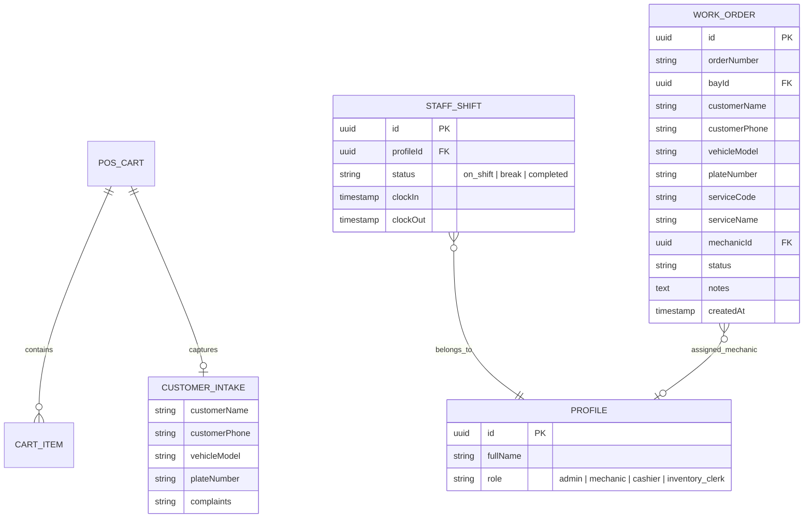

# Feature Specification: POS Customer & Complaint Intake Prompt with Admin On-Shift Mechanic Dispatch

**Feature Branch**: `feat/SIAA-101-pos-customer-intake-admin-mechanic-dispatch`  
**Created**: 2026-10-26  
**Status**: Ready for Planning  
**Jira Ticket**: [SIAA-101](https://the-three-devsketeers.atlassian.net/browse/SIAA-101) (STORY-5.12)  
**Parent Epic**: [SIAA-5](https://the-three-devsketeers.atlassian.net/browse/SIAA-5) (EPIC-5: Staff Shop Floor Terminal & Time Clock)  
**Prerequisites**: [SIAA-100](https://the-three-devsketeers.atlassian.net/browse/SIAA-100) (STORY-5.11: POS Labor Checkout to Service Bay Work Order Queue Bridge), [SIAA-99](https://the-three-devsketeers.atlassian.net/browse/SIAA-99) (STORY-5.10: Dedicated Mechanic Workshop Queue), [SIAA-66](https://the-three-devsketeers.atlassian.net/browse/SIAA-66) (STORY-6.6: Supabase Service Bay Work Orders Schema), [SIAA-17](https://the-three-devsketeers.atlassian.net/browse/SIAA-17) (STORY-5.3: Staff Shift Punch & Time Clock RPCs)  
**Related Features**: [SIAA-35](https://the-three-devsketeers.atlassian.net/browse/SIAA-35) (Live Bay Utilization & Mechanic Monitor), [SIAA-18](https://the-three-devsketeers.atlassian.net/browse/SIAA-18) (Hybrid POS Cart & Workshop Labor Line-Item Engine)  

---

## Executive Summary & Business Intent

In high-volume motorcycle parts retail and repair service centers, accurate record keeping during customer intake is critical for diagnostic precision, mechanic safety, customer communication, and dispute prevention. When repair or maintenance services are billed at the Point of Sale (`/staff/pos` or `/admin/pos`), workshop technicians require explicit motorcycle details (make, model, plate number), contact numbers for status updates, and detailed customer complaint descriptions (e.g., "front brake squeal under heavy braking", "engine stalls at idle when cold").

While feature SIAA-100 established the automatic bridge between POS checkout and the workshop queue by auto-provisioning work orders when labor service items are present, it utilized default placeholder attributes ("Walk-in Customer", "0917-000-0000", generic strings) to avoid blocking fast-lane transactions without an intake capture step. Furthermore, work orders remained purely unassigned, relying solely on floor mechanic self-dispatch ("Claim Job").

This feature delivers two core operational capabilities:
1. **Interactive Customer & Complaint Intake Prompt at POS**: Automatically intercepts checkout on both Cashier and Admin POS when one or more labor service line items (`item_type = 'service'`) exist in the cart. Prompts for customer name, validated contact phone number, vehicle model, license plate number, and complaint notes before proceeding to the payment modal. These values are persisted into `public.work_orders` and displayed across the Workshop Queue (`/staff/work-orders`) and Detail Drawer without generic mock fallbacks.
2. **Admin On-Shift Mechanic Work Order Dispatch**: Provides shop managers and admins with an interactive assignment dropdown inside the Workshop Queue and Detail Drawer, dynamically filtered to only mechanics who currently have an active clock-in (`status = 'on_shift'`). Selecting a mechanic invokes `assignMechanicAction`, updating `public.work_orders.mechanic_id`, broadcasting in real-time over `operational-intelligence`, and updating the UI in <500ms. Floor mechanics and cashiers retain role-based protection where this dropdown is hidden or read-only, maintaining standard self-dispatch for technicians.

---

## User Scenarios & Testing *(mandatory)*

### User Story 1 - Cashier & Admin POS Customer & Complaint Intake Prompt (Priority: P1)

* **As a** Cashier or Shop Floor Terminal user,  
* **I want** the POS system to prompt for the customer's name, contact number, vehicle details, and complaint notes before proceeding to checkout when labor or repair services are present,  
* **so that** accurate customer information and repair complaints are recorded into the database and seamlessly attached to the resulting work order and transaction receipt.

**Why this priority**: Essential customer service and workshop workflow prerequisite. Mechanics cannot service motorcycles effectively without accurate customer complaints and vehicle identity.

**Independent Test**: Add a labor service item (e.g., "Full Synthetic Oil Change") to cart at `/staff/pos` or `/admin/pos`, click "Complete Sale" (or press F12), and confirm that the "Customer & Vehicle Intake" dialog appears before the cash payment modal.

**Acceptance Scenarios**:
```gherkin
Scenario: Interactive Customer Intake Modal at Checkout
  Given a cashier or admin at the POS with a cart containing at least one labor service item ("item_type = 'service'")
  When the user clicks "Complete Sale" (or presses F12)
  Then the system intercepts and opens a "Customer & Vehicle Intake" dialog before opening the cash tender modal
  And the modal prompts for:
    | field                 | requirement                                                        | validation                                    |
    | Customer Full Name    | Required                                                          | Non-empty string, min 2 characters            |
    | Contact Phone Number  | Required                                                          | Philippine mobile: 09XX-XXX-XXXX or 11 digits |
    | Vehicle Model         | Required for service jobs                                         | Non-empty string (e.g. "Yamaha NMAX 155")     |
    | Plate Number          | Required for service jobs                                         | Non-empty string or standard format           |
    | Customer Complaints   | Required                                                          | Detailed reason for intake / symptoms         |
  And submitting valid intake values opens the Cash Tender Modal with the intake data held in checkout state.

Scenario: Pure Parts Cart Bypasses Intake Modal
  Given a cashier or admin at POS with a cart containing only physical parts ("item_type = 'part'")
  When the user clicks "Complete Sale" (or presses F12)
  Then the Customer Intake Modal is completely bypassed
  And the Cash Tender Modal opens immediately for fast-lane retail checkout.

Scenario: Intake Modal Validation Errors Prevent Progression
  Given the Customer Intake Modal is open
  When the user submits an empty customer name or an invalid phone number (e.g., "12345" or letters)
  Then inline validation error messages highlight the invalid fields
  And the modal remains open without advancing to payment tender.
```

---

### User Story 2 - Real Database Persistence into Supabase (Priority: P1)

* **As a** Workshop Technician or Shop Supervisor,  
* **I want** work order records created from POS checkout to persist the exact customer name, phone number, vehicle info, and complaints,  
* **so that** the Work Order Detail Drawer and queue cards display real customer data rather than generic placeholder fallbacks.

**Why this priority**: Directly satisfies Jira Scenario 2. Eliminates hardcoded "Walk-in Customer" and "0917-000-0000" placeholders.

**Independent Test**: Complete a checkout with intake details `Customer: Maria Santos`, `Phone: 0918-123-4567`, `Vehicle: Honda Click 125i`, `Plate: 123-ABC`, `Complaints: Squeaking sound on rear wheel`. Open the Work Order Detail Drawer at `/staff/work-orders` and verify all fields match exactly.

**Acceptance Scenarios**:
```gherkin
Scenario: Real Database Persistence into Supabase
  Given complete customer intake data captured in User Story 1
  When payment is tendered and checkout completes
  Then the record in "public.work_orders" is inserted with:
    | column                | value                                                |
    | customer_name         | exact customer name from intake (e.g. "Maria Santos")|
    | customer_phone        | exact phone number from intake (e.g. "0918-123-4567")|
    | notes                 | full customer complaints and diagnosis notes         |
    | vehicle_model         | motorcycle model from intake                         |
    | plate_number          | customer license plate from intake                   |
  And the Work Order Detail Drawer ("/staff/work-orders" and "/admin/workshop") displays the real customer name, real phone number, and real complaints instead of mock or generic fallbacks ("Walk-in Customer", "0917-000-0000", generic strings).
```

---

### User Story 3 - Admin On-Shift Mechanic Work Order Dispatch (Priority: P1)

* **As an** Admin or Shop Manager,  
* **I want** to select from a list of currently on-shift mechanics and assign them directly to any queued or unassigned work order,  
* **so that** work can be actively distributed across the workshop floor rather than relying solely on mechanic self-dispatch.

**Why this priority**: Solves workshop floor bottleneck where queued jobs sit unassigned or supervisory load balancing is needed.

**Independent Test**: In Admin view, open an unassigned work order in the Workshop Queue or Detail Drawer. Select an on-shift mechanic from the assignment dropdown. Verify the order updates to show the selected mechanic and status transitions or displays the assignment.

**Acceptance Scenarios**:
```gherkin
Scenario: Admin On-Shift Mechanic Assignment Selector
  Given an authenticated Admin user viewing an unassigned or queued work order in the Workshop Queue or Detail Drawer
  When viewing the "Assigned Mechanic" field
  Then the admin sees an "Assign Mechanic" interactive dropdown
  And the dropdown options dynamically filter to display only technicians who currently have an active clock-in ("status = 'on_shift'" in "public.staff_shifts" or active attendance roster)
  And selecting a mechanic triggers "assignMechanicAction", updating "public.work_orders.mechanic_id", broadcasting to "operational-intelligence", and updating the UI in <500ms.

Scenario: Realtime Broadcast on Mechanic Assignment
  Given a mechanic viewing "/staff/work-orders"
  When an admin assigns a work order to that mechanic via "assignMechanicAction"
  Then the change event broadcasts over "operational-intelligence"
  And the mechanic's queue updates reactively, showing the assigned job under "My Active Jobs" without page reload.
```

---

### User Story 4 - Role-Based Protection for Mechanic Assignment (Priority: P2)

* **As a** Cashier or Floor Mechanic,  
* **I want** the Admin assignment dropdown to be protected or read-only,  
* **so that** mechanics cannot reassign arbitrary jobs to other technicians and continue utilizing the standard self-dispatch "Claim Job" button for unassigned orders.

**Why this priority**: Prevents unauthorized reassignment on kiosk or cashier stations while maintaining self-dispatch autonomy for mechanics.

**Independent Test**: Log in with role `Cashier` or `Mechanic`, open an unassigned work order, and verify the mechanic assignment dropdown is not interactive / not present, while "Claim Job" is available for mechanics.

**Acceptance Scenarios**:
```gherkin
Scenario: Role-Based Protection for Mechanic Assignment
  Given a logged-in user with role "Cashier" or "Mechanic"
  When viewing the work order details
  Then the Admin assignment dropdown is hidden or read-only
  And mechanics continue to utilize the standard self-dispatch "Claim Job" button for unassigned orders.
```

---

## Functional Requirements

- **FR-001**: The POS checkout flow (`/staff/pos` and `/admin/pos`) MUST detect when `items` contains one or more line items where `itemType === 'service'`.
- **FR-002**: When service items are present, triggering "Complete Sale" or pressing `F12` MUST open `CustomerIntakeModal` before `PaymentModal` opens.
- **FR-003**: `CustomerIntakeModal` MUST enforce required fields: Customer Name, Phone Number, Vehicle Model, Plate Number, and Complaints/Notes.
- **FR-004**: Phone numbers MUST be validated against the standard Philippine mobile phone format (`^09\d{9}$` or `^09\d{2}-\d{3}-\d{4}$`).
- **FR-005**: If the cart contains only physical parts (`itemType === 'part'`), the intake modal MUST NOT appear, immediately opening `PaymentModal`.
- **FR-006**: Submitting `CustomerIntakeModal` MUST pass validated customer details (`customerName`, `customerPhone`, `vehicleModel`, `plateNumber`, `notes`) into the cart store / checkout payload.
- **FR-007**: `autoProvisionWorkOrdersFromCheckout` in `lib/pos/work-order-bridge.ts` MUST persist `customerName`, `customerPhone`, `vehicleModel`, `plateNumber`, and `notes` to both Supabase PostgreSQL (`public.work_orders`) and the in-memory fallback cache.
- **FR-008**: The Work Order Detail Drawer and Work Order Cards MUST display real customer name, phone number, vehicle details, and complaint notes without falling back to mock defaults.
- **FR-009**: The system MUST provide `fetchOnShiftMechanicsAction` to query active mechanics with `status = 'on_shift'` in `public.staff_shifts` / active punch roster.
- **FR-010**: The system MUST provide `assignMechanicAction(orderId, mechanicId, mechanicName)` that updates `public.work_orders.mechanic_id`, revalidates paths, and broadcasts `WORK_ORDER_ASSIGNED` over `operational-intelligence`.
- **FR-011**: In the Workshop Queue and Detail Drawer, when accessed by an Admin or Shop Manager, the "Assigned Mechanic" field MUST display an interactive selector populated by `fetchOnShiftMechanicsAction`.
- **FR-012**: When viewed by non-admin roles (Cashier or Mechanic), the mechanic selector MUST be hidden or read-only, allowing mechanics to claim jobs via the canonical "Claim Job" button.

---

## Success Criteria

1. **Intake Flow Interception**: 100% of checkouts containing labor services trigger the customer intake prompt before tender; 0% of pure parts checkouts are blocked.
2. **Data Fidelity**: 100% of newly created work orders have non-null, real customer phone, customer name, vehicle model, and complaints. Zero occurrences of default placeholder `"0917-000-0000"` or `"Walk-in Customer"` when customer intake was completed.
3. **Dispatch Speed**: Admin mechanic assignment updates database, in-memory state, and emits Realtime broadcast with UI update in under 500ms.
4. **Role Boundary Enforcement**: Mechanics and cashiers cannot access the admin mechanic dispatch selector.
5. **Design System Adherence**: All new modals, form inputs, and select dropdowns strictly use semantic tokens from `lib/tokens.ts` and `app/globals.css`.

---

## Key Entities & Data Schema Mapping



---

## Assumptions & Dependencies

- **Pre-existing Bridge**: Feature SIAA-100 created `lib/pos/work-order-bridge.ts`. This feature extends `CheckoutPayload`, `checkoutPayloadSchema`, and `autoProvisionWorkOrdersFromCheckout` to carry and persist `customerPhone`.
- **On-Shift Mechanics Data**: SIAA-60/SIAA-61 provided `staff_shifts` and `profiles`. When running offline or in mock environments, fallback on-shift mechanics are derived from `usePunchStore` active records or seeded active mechanics (`Dante Reyes`, `Alex Lim`).
- **Realtime Broadcast**: Channel `operational-intelligence` is already subscribed in `WorkshopQueueClient` and `useExecutiveRealtime`.
