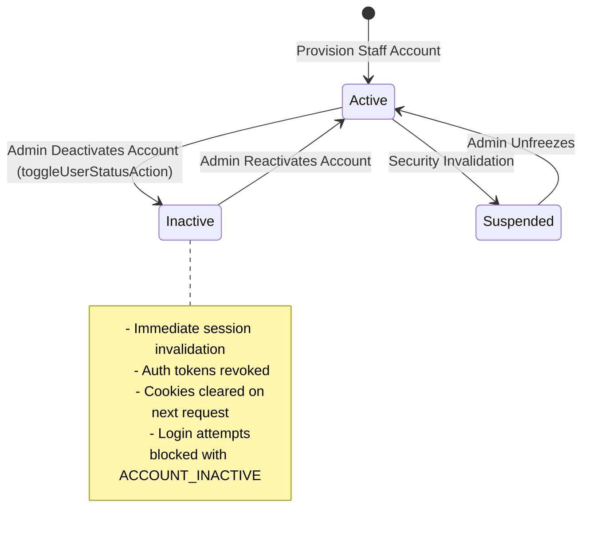

# Data Model: SIAA-103 Inactive Staff Auth Blocking & Session Revocation

**Feature**: Immediate Auth Blocking & Session Revocation for Inactive Staff Accounts  
**Branch**: `feat/SIAA-103-auth-block-login-revoke-sessions-inactive-staff`  
**Date**: 2026-10-26  

---

## 1. Domain Entities & State Machine

### 1.1 Account Status State Machine


### 1.2 Entity Specifications

#### `StaffAccountStatus`
```typescript
export type StaffAccountStatus = 'Active' | 'Inactive' | 'Suspended';
```

#### `StaffProfileRecord` (Database Entity in `public.profiles`)
| Field | Type | Nullable | Description |
|---|---|---|---|
| `id` | `UUID` (PK) | No | Unique staff identifier, foreign key to `auth.users(id)` |
| `email` | `VARCHAR(255)` | No | Normalized lowercase email address |
| `full_name` | `VARCHAR(255)` | No | Staff display name |
| `role` | `VARCHAR(50)` | No | Base role (`admin`, `cashier`, `mechanic`, `inventory`) |
| `status` | `VARCHAR(20)` | No | Account status: `'Active'`, `'Inactive'`, `'Suspended'` |
| `pin_code` | `VARCHAR(10)` | Yes | 4-digit numeric kiosk PIN |
| `permissions` | `JSONB` | Yes | Granular capability flags |
| `created_at` | `TIMESTAMPTZ` | No | Timestamp of initial account creation |
| `updated_at` | `TIMESTAMPTZ` | No | Timestamp of last status or profile modification |

---

## 2. Session & Guard Data Models

### 2.1 Resolved Session Interface
```typescript
export interface ResolvedSession {
  isAuthenticated: boolean;
  role: PortalRole | null;
  userId?: string;
  source: "supabase" | "demo" | "none";
  status?: StaffAccountStatus;
  isInactive?: boolean;
}
```

### 2.2 Route Guard Decision
```typescript
export interface GuardDecision {
  action: "ALLOW" | "REDIRECT";
  destination?: string;
  statusCode?: 307 | 308;
  reason?: "UNAUTHENTICATED" | "ROLE_UNAUTHORIZED" | "ACCOUNT_INACTIVE";
}
```

### 2.3 Authentication Results
```typescript
export interface AuthResult {
  success: boolean;
  redirectTo?: string;
  session?: UserSession;
  error?: string;
  code?: 
    | 'ACCOUNT_INACTIVE'
    | 'INVALID_CREDENTIALS'
    | 'NETWORK_ERROR'
    | 'VALIDATION_ERROR'
    | 'UNAUTHORIZED';
}

export interface VerifyStaffPinResult {
  success: boolean;
  profile?: {
    id: string;
    name: string;
    email: string;
    role: string;
    roleDisplay: string;
    avatarInitials: string;
    permissions: StaffPermissions;
  };
  error?: string;
  code?: 
    | 'ACCOUNT_INACTIVE'
    | 'INVALID_PIN'
    | 'PROFILE_NOT_FOUND'
    | 'DATABASE_ERROR'
    | 'UNAUTHORIZED';
}
```

---

## 3. Cookie Storage Specification

| Cookie Name | Purpose | Retention | Cleared On Deactivation |
|---|---|---|---|
| `swift-session-role` | Encodes user portal role (`admin`, `staff`) | Session or 30 days | **YES** |
| `swift-user-name` | Display name for header | Session or 30 days | **YES** |
| `swift-session-user-id` | UUID of authenticated user | Session or 30 days | **YES** |
| `swift_admin_elevated` | Temporary elevation flag | 15 mins / Session | **YES** |
| `swift_active_shift_id`| Active shift tracking | Shift duration | **YES** |
| `sb-<project>-auth-token`| Supabase SSR session token | Session / Refresh | **YES (via admin signOut)** |
