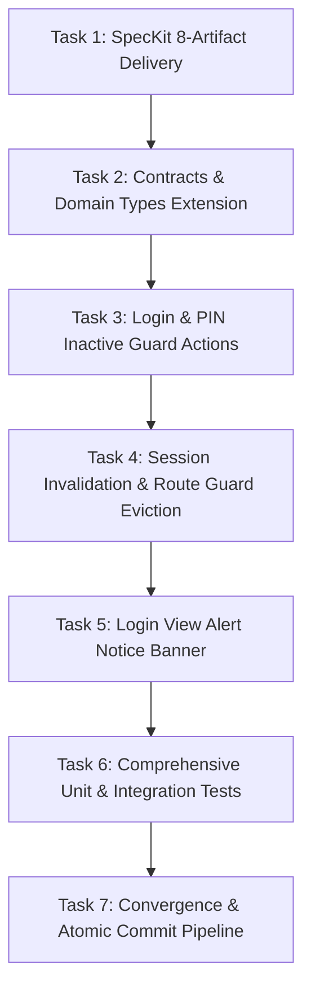

# Implementation Tasks: Immediate Auth Blocking & Session Revocation for Inactive Staff Accounts

**Feature**: `103-auth-block-login-revoke-sessions-inactive-staff`  
**Jira Ticket**: [SIAA-103](https://the-three-devsketeers.atlassian.net/browse/SIAA-103)  
**Branch**: `feat/SIAA-103-auth-block-login-revoke-sessions-inactive-staff`  

---

## Task Overview & Dependency Graph

---

## Phase 1: Specifications & Contracts (Unit 1)

- [x] **TASK-01**: Author canonical 8 SpecKit artifacts in `specs/103-auth-block-login-revoke-sessions-inactive-staff/`
  - **Files**: `spec.md`, `research.md`, `data-model.md`, `contracts/inactive-auth-contracts.ts`, `checklists/requirements.md`, `plan.md`, `quickstart.md`, `tasks.md`
  - **Verification**: All 8 artifacts present, self-consistent, zero unfilled placeholders.

---

## Phase 2: Domain Types & Inactive Code Contracts (Unit 2)

- [x] **TASK-02**: Extend Auth & Session Types with `ACCOUNT_INACTIVE` Code and Inactive Session Flags
  - **Files**:
    - `lib/auth/types.ts`: Add `'ACCOUNT_INACTIVE'` to `AuthResult['code']` and add optional `status?: string` & `isInactive?: boolean` to `UserSession` and `ResolvedSession`.
    - `lib/staff/types.ts`: Add `'ACCOUNT_INACTIVE'` to `VerifyStaffPinResult['code']`.
  - **Verification**: `npx tsc --noEmit` compiles cleanly.

---

## Phase 3: Login Authentication Guard & Inactive Account Blocking (Unit 3)

- [x] **TASK-03**: Update `authenticateUserAction` in `lib/auth/actions.ts` to Check Account Status
  - **Files**: `lib/auth/actions.ts`
  - **Changes**:
    - Check user profile status against `public.profiles` (or `memoryStaffUsers` / mock data if demo/offline).
    - If status is `Inactive` or `Suspended`:
      - Return `{ success: false, code: 'ACCOUNT_INACTIVE', error: 'Account is inactive. Please contact your workshop administrator.' }`.
      - Prohibit cookie creation.
      - Log security audit event for rejected login.
  - **Verification**: Test with inactive email credentials returns exact prescribed error.

- [x] **TASK-04**: Update `verifyStaffPinAction` in `lib/staff/actions.ts` to Block Inactive Staff PINs
  - **Files**: `lib/staff/actions.ts`
  - **Changes**:
    - In `verifyStaffPinFromSupabase` and `verifyStaffPinOfflineFallback`:
      - Inspect `data.status` or `mockProfile.status`.
      - If status is `Inactive`, return early with `{ success: false, code: 'ACCOUNT_INACTIVE', error: 'Account is inactive. Please contact your workshop administrator.' }`.
  - **Verification**: Test with inactive staff PIN returns `ACCOUNT_INACTIVE`.

---

## Phase 4: Session Invalidation & Route Guard Eviction (Unit 4)

- [x] **TASK-05**: Implement Administrative Session Revocation in `toggleUserStatusAction`
  - **Files**: `lib/admin/user-actions.ts`
  - **Changes**:
    - When `status === 'Inactive'`, invoke Supabase Admin Auth `signOut(userId, 'global')` to revoke tokens.
    - Record deactivation timestamp in user record and revocation registry.
    - Log high-severity security audit event: `ACCOUNT_DEACTIVATED_SESSION_TERMINATED`.
  - **Verification**: Status toggle executes cleanly and triggers session termination hook.

- [x] **TASK-06**: Update `getServerSession()` & `evaluateRouteAccess()` in `lib/auth/session-guards.ts`
  - **Files**: `lib/auth/session-guards.ts`
  - **Changes**:
    - Retrieve active account status for the resolved user ID.
    - If `status === 'Inactive'`:
      - Set `isInactive: true`, `isAuthenticated: false`.
      - Clear session cookies: `swift-session-role`, `swift-user-name`, `swift-session-user-id`, `swift_admin_elevated`, `swift_active_shift_id`.
    - In `evaluateRouteAccess()`:
      - If `session.isInactive` is true, redirect immediately to `/login?notice=inactive` with status 307.
  - **Verification**: Subsequent route navigation from inactive user is intercepted and redirected.

---

## Phase 5: UI Login Notice Banner & Accessibility (Unit 5)

- [x] **TASK-07**: Update Login Views to Display Accessible Inactive Notice Banner
  - **Files**:
    - `components/auth/login-form.tsx`: Add check for `notice === 'inactive'` or `error === 'ACCOUNT_INACTIVE'`. Render warning card with `AlertTriangle` icon and text *"Account is inactive. Please contact your workshop administrator."* using semantic design tokens (`var(--destructive)`).
    - `app/(auth)/login/page.tsx`: Pass URL search parameters (`notice`, `error`) to `LoginForm`.
  - **Verification**: Direct navigation to `/login?notice=inactive` displays the warning banner.

---

## Phase 6: Automated Test Suites & Regression Verification (Unit 6)

- [x] **TASK-08**: Author Unit and Integration Tests for Inactive Account Security
  - **Files**:
    - `lib/auth/__tests__/inactive-account-guard.test.ts`
    - `lib/staff/__tests__/inactive-staff-pin.test.ts`
    - `lib/auth/__tests__/session-revocation.test.ts`
    - `lib/admin/__tests__/user-deactivation-revocation.test.ts`
  - **Verification**: All new test suites pass with 100% assertions satisfied.

- [x] **TASK-09**: Full Regression Verification & Graphify AST Update
  - **Verification**:
    - `npm test` passes 100% (715/715 tests).
    - `npx tsc --noEmit` passes with 0 errors.
    - `npm run lint` passes cleanly.
