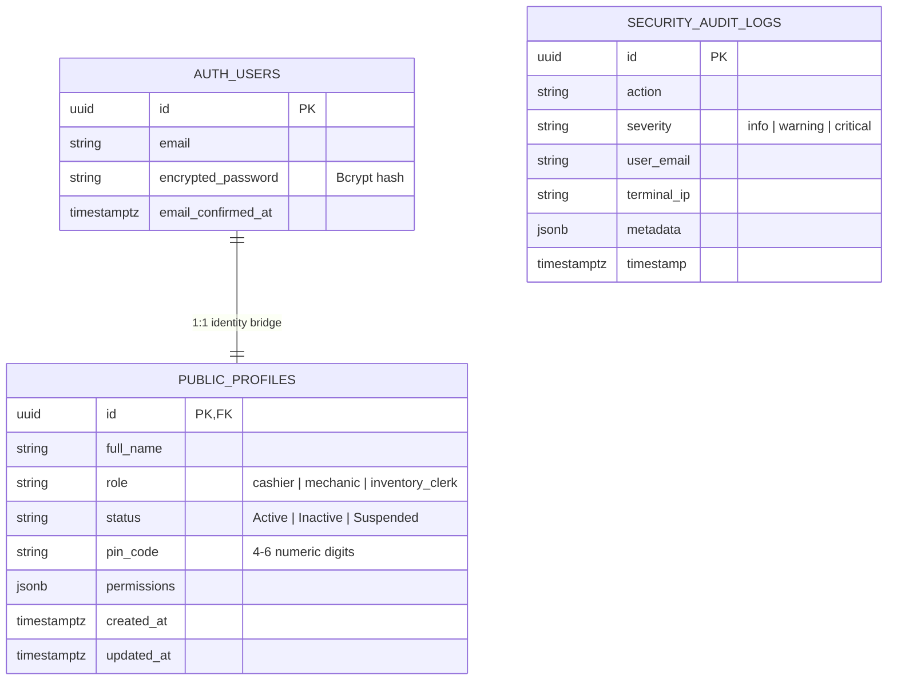

# Data Model: Staff Credential Provisioning & Reset (SIAA-104)

**Feature**: Admin: Provision email, password, and PIN for staff with credential reset capability  
**Ticket**: [SIAA-104](https://the-three-devsketeers.atlassian.net/browse/SIAA-104)  
**Date**: 2026-10-26  

---

## 1. Relational Entities & Storage Mappings



### Table Definitions

#### `public.profiles`
| Column | Type | Constraints | Description |
| :--- | :--- | :--- | :--- |
| `id` | `UUID` | PK, FK -> `auth.users(id)` | Unique staff account identifier |
| `full_name` | `VARCHAR(255)` | NOT NULL | Employee full legal/display name |
| `role` | `VARCHAR(50)` | NOT NULL | Operational workstation role (`cashier`, `mechanic`, `inventory_clerk`) |
| `status` | `VARCHAR(20)` | DEFAULT `'Active'` | Account operational status |
| `pin_code` | `VARCHAR(10)` | DEFAULT `'1234'` | Shop-floor terminal authentication PIN (4 to 6 numeric digits) |
| `permissions` | `JSONB` | DEFAULT `{}` | Fine-grained operational permissions |
| `created_at` | `TIMESTAMPTZ` | DEFAULT `NOW()` | Timestamp account created |
| `updated_at` | `TIMESTAMPTZ` | DEFAULT `NOW()` | Timestamp account updated |

---

## 2. In-Memory Mock Schema (`lib/mock-data/users.ts`)

```typescript
export interface MockStaffUserProfile {
  id: string;
  name: string;
  email: string;
  role: DbUserRole;
  roleDisplay: string;
  status: 'Active' | 'Inactive' | 'Suspended';
  permissions: StaffPermissions;
  pinCode?: string; // 4 to 6 numeric digits (SIAA-104)
  createdAt: string;
  updatedAt: string;
}
```

---

## 3. Data Transfer Objects & Payloads

### Provision Staff User Request
```typescript
export interface ProvisionStaffWithCredentialsPayload {
  fullName: string;
  email: string;
  role: 'cashier' | 'mechanic' | 'inventory_clerk';
  password: string; // min 6 chars
  pin: string;      // 4 to 6 numeric digits
}
```

### Reset Staff Credentials Request
```typescript
export interface ResetStaffCredentialsPayload {
  userId: string;
  password: string; // min 6 chars
  pin: string;      // 4 to 6 numeric digits
}
```

### Reset Staff Credentials Result
```typescript
export interface ResetStaffCredentialsResult {
  success: boolean;
  message?: string;
  error?: string;
  code?: 'SUCCESS' | 'UNAUTHORIZED' | 'VALIDATION_ERROR' | 'USER_NOT_FOUND' | 'INTERNAL_ERROR';
  updatedAt?: string;
}
```
