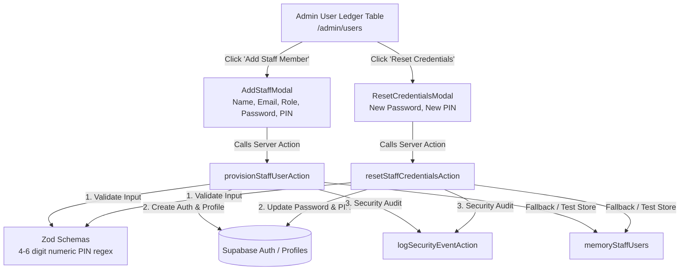

# Technical Implementation Plan: Staff Credential Provisioning & Reset (SIAA-104)

**Feature**: Admin: Provision email, password, and PIN for staff with credential reset capability  
**Ticket**: [SIAA-104](https://the-three-devsketeers.atlassian.net/browse/SIAA-104)  
**Date**: 2026-10-26  

---

## 1. System Architecture & Component Mapping

---

## 2. File Modification & Creation Inventory

| File Path | Action | Description |
| :--- | :--- | :--- |
| `specs/104-staff-credential-provisioning-and-reset/*` | Create | 8 canonical SpecKit artifacts. |
| `specs/104-staff-credential-provisioning-and-reset/contracts/credentials.contract.ts` | Create | Zod validation schemas for PIN, Password, Provisioning, and Reset. |
| `lib/mock-data/users.ts` | Modify | Add `pinCode?: string` to `MockStaffUserProfile` interface and baseline objects. |
| `lib/admin/user-actions.ts` | Modify | Update `provisionStaffUserAction` to persist `password` and `pin`; add `resetStaffCredentialsAction`. |
| `components/admin/users/add-staff-modal.tsx` | Modify | Add Temporary Password and PIN input fields with client validation. |
| `components/admin/users/reset-credentials-modal.tsx` | Create | Dedicated modal for resetting staff password and PIN. |
| `components/admin/users/user-ledger-table.tsx` | Modify | Add "Reset Credentials" action button and wire `ResetCredentialsModal`. |
| `lib/admin/__tests__/user-actions.test.ts` | Modify | Unit tests verifying credential provisioning, PIN validation (`/^\d{4,6}$/`), and credential reset. |
| `swift-backend/.../dto/ResetCredentialsRequest.java` | Create | DTO for Spring Boot credential reset endpoint. |
| `swift-backend/.../service/UserAdminService.java` | Modify | Add `resetCredentials` method definition. |
| `swift-backend/.../service/impl/UserAdminServiceImpl.java` | Modify | Implement `resetCredentials` with PIN validation, bcrypt/pin update, and audit log. |
| `swift-backend/.../controller/UserAdminController.java` | Modify | Expose `POST /api/v1/admin/users/{id}/reset-credentials`. |
| `swift-backend/.../UserAdminControllerTests.java` | Modify | Controller tests verifying credential reset and PIN validation. |

---

## 3. Test Strategy & Acceptance Matrix

1. **PIN Formatting Validation**:
   - Alpha input (e.g. `12ab`) -> rejects with `"PIN must consist of 4 to 6 numeric digits."`
   - Short input (e.g. `123`) -> rejects with `"PIN must consist of 4 to 6 numeric digits."`
   - Long input (e.g. `1234567`) -> rejects with `"PIN must consist of 4 to 6 numeric digits."`
   - Valid 4-digit input (`1234`) -> accepted.
   - Valid 6-digit input (`654321`) -> accepted.
2. **Provisioning with Full Credentials**:
   - Submitting full name, email, password, and valid 4-6 digit PIN -> creates account, updates `pin_code`, returns active profile.
3. **Resetting Credentials**:
   - Resetting existing staff password and PIN -> updates user password and PIN, returns success.
   - Non-existent user -> returns `USER_NOT_FOUND`.
   - Non-admin caller -> returns `UNAUTHORIZED`.
