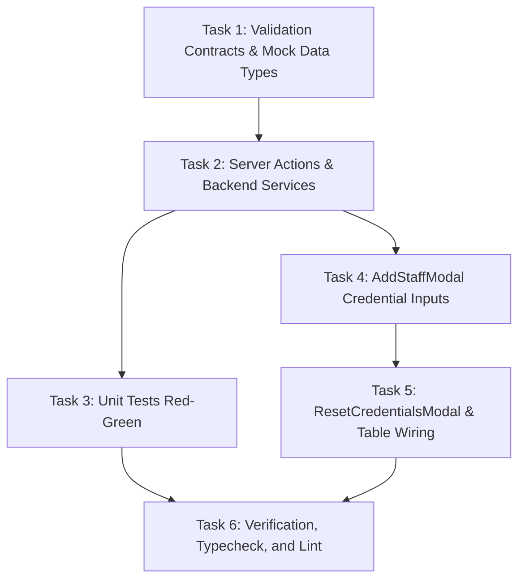

# Implementation Tasks: Staff Credential Provisioning & Reset (SIAA-104)

**Feature**: Admin: Provision email, password, and PIN for staff with credential reset capability  
**Ticket**: [SIAA-104](https://the-three-devsketeers.atlassian.net/browse/SIAA-104)  
**Date**: 2026-10-26  

---

## Task Overview & Dependency Graph

---

## Tasks

### Phase 1: Setup, Schemas & Data Contracts
- [ ] **Task 1.1**: Define validation schemas and interfaces in `specs/104-staff-credential-provisioning-and-reset/contracts/credentials.contract.ts` (`StaffPinSchema`, `StaffPasswordSchema`, `ResetStaffCredentialsSchema`, `ProvisionStaffCredentialsSchema`).
- [ ] **Task 1.2**: Update `MockStaffUserProfile` in `lib/mock-data/users.ts` to include `pinCode?: string`.

### Phase 2: Domain Logic & Server Actions
- [ ] **Task 2.1**: Update `provisionStaffUserAction` in `lib/admin/user-actions.ts` to accept and persist `password` and `pin` (updating `pin_code` in `public.profiles` / memory store and logging security audit).
- [ ] **Task 2.2**: Implement `resetStaffCredentialsAction` in `lib/admin/user-actions.ts` with admin role guard, 4-6 digit numeric PIN validation, password update, `pin_code` update, and audit log.
- [ ] **Task 2.3**: Update Spring Boot backend (`ResetCredentialsRequest.java`, `UserAdminService.java`, `UserAdminServiceImpl.java`, `UserAdminController.java`) for parity endpoint `POST /api/v1/admin/users/{id}/reset-credentials`.

### Phase 3: UI Modals & Ledger Table Integration
- [ ] **Task 3.1**: Update `AddStaffModal` (`components/admin/users/add-staff-modal.tsx`) to add Temporary Password and Numeric PIN fields with instant formatting validation.
- [ ] **Task 3.2**: Create `ResetCredentialsModal` (`components/admin/users/reset-credentials-modal.tsx`) with user identity header, new password, numeric PIN fields, and error handling.
- [ ] **Task 3.3**: Wire "Reset Credentials" button into `UserLedgerTable` (`components/admin/users/user-ledger-table.tsx`) and connect state to `ResetCredentialsModal`.

### Phase 4: Automated Testing & Verification
- [ ] **Task 4.1**: Add comprehensive unit tests in `lib/admin/__tests__/user-actions.test.ts` testing PIN regex (`/^\d{4,6}$/`), credential provisioning, and credential reset.
- [ ] **Task 4.2**: Update Spring Boot `UserAdminControllerTests.java` to test `/reset-credentials` endpoint.
- [ ] **Task 4.3**: Run `npx vitest run lib/admin/__tests__/user-actions.test.ts` and verify all tests pass.
- [ ] **Task 4.4**: Run `npx tsc --noEmit` and verify zero type errors.

### Phase 5: Final Convergence
- [ ] **Task 5.1**: Mark all tasks completed in `tasks.md`.
- [ ] **Task 5.2**: Commit changes atomically following `.agents/rules/atomic-commit.md`.
