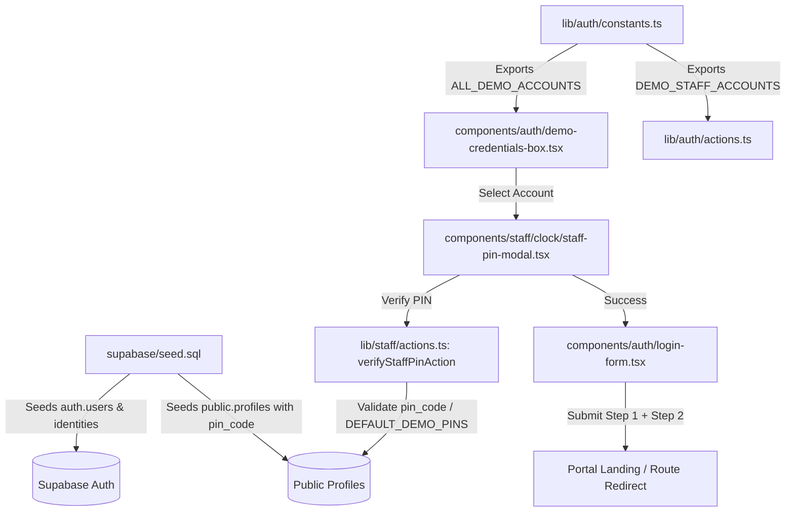

# Implementation Plan: Seed 3 Baseline Staff Profiles & Credentials

**Feature Branch**: `feat/SIAA-105-auth-seed-baseline-staff-profiles`  
**Created**: 2026-10-26  
**Jira Ticket**: [SIAA-105](https://the-three-devsketeers.atlassian.net/browse/SIAA-105)  
**Parent Epic**: [SIAA-8](https://the-three-devsketeers.atlassian.net/browse/SIAA-8) (Authentication & RBAC)

---

## 1. Architecture & Component Hierarchy

---

## 2. File Change Manifest

| File Path | Action | Description |
| :--- | :--- | :--- |
| `supabase/seed.sql` | Modify | Seed 3 baseline staff accounts (`cashier@swift.local` / Mike Morales, `mechanic1@swift.local` / Dante Reyes, `warehouse@swift.local` / Rico Santos) with `auth.users`, `auth.identities`, and `public.profiles` records including explicit `pin_code`. |
| `lib/auth/types.ts` | Modify | Enhance `DemoAccount` interface with `id`, `name`, `staffRole`, and `pin`. |
| `lib/auth/constants.ts` | Modify | Define `DEMO_ADMIN_ACCOUNT`, `DEMO_STAFF_ACCOUNTS` (3 baseline staff accounts), `ALL_DEMO_ACCOUNTS`, and dedicated 4-digit PINs. |
| `lib/auth/actions.ts` | Modify | Enhance `resolveDemoAccount` to inspect `ALL_DEMO_ACCOUNTS` and redirect to account-specific `targetUrl`. |
| `components/auth/demo-credentials-box.tsx` | Modify | Display all baseline accounts (Admin + 3 staff roles) with avatar badges and dedicated PIN prompts via `StaffPinModal`. |
| `components/auth/login-form.tsx` | Modify | Ensure seamless two-step login experience and state sync with `punchStore`. |
| `lib/auth/__tests__/demo-staff-credentials.test.ts` | Create | Automated unit & contract tests verifying all 4 accounts, 4-digit PIN constraints, and PIN validation actions. |

---

## 3. Test & Verification Plan

1. **Automated Unit Tests**:
   - `npm test lib/auth/__tests__/demo-staff-credentials.test.ts`
   - Test 1: Verify all 4 demo accounts (Admin + Cashier + Mechanic + Inventory Clerk) exist with required fields.
   - Test 2: Verify backwards compatibility of `DEMO_ACCOUNTS`.
   - Test 3: Verify PIN codes match `DEFAULT_DEMO_PINS` and `verifyStaffPinAction` accepts correct PINs.
   - Test 4: Verify rejection of invalid or malformed PINs.
2. **Static Analysis & Type Safety**:
   - `npm run lint`
   - `npx tsc --noEmit`
3. **Seed Script Validation**:
   - Verify SQL syntax and idempotent conflict handling for all 3 staff accounts in `supabase/seed.sql`.
