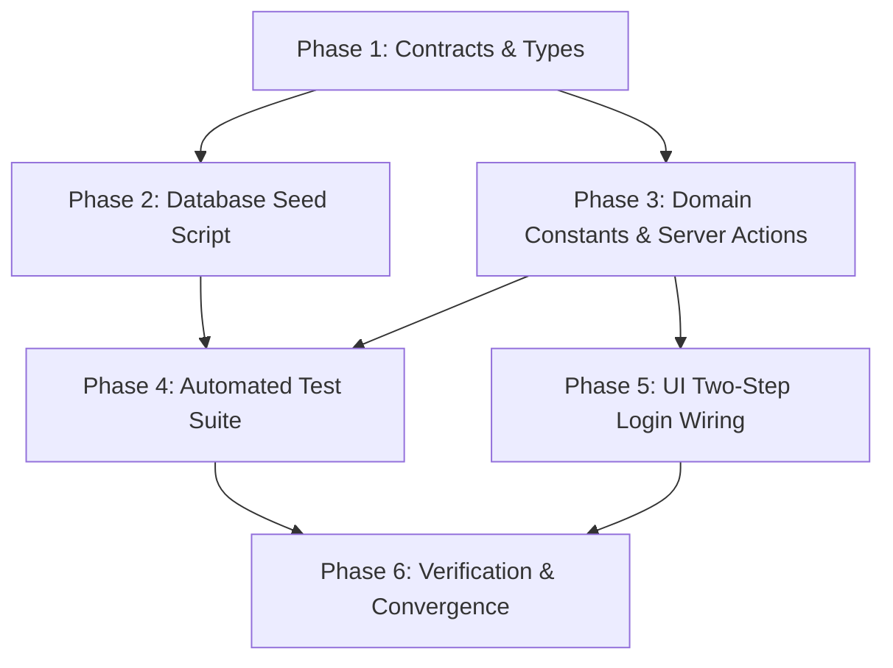

# Implementation Tasks: Seed 3 Baseline Staff Profiles & Credentials

**Feature Branch**: `feat/SIAA-105-auth-seed-baseline-staff-profiles`  
**Created**: 2026-10-26  
**Jira Ticket**: [SIAA-105](https://the-three-devsketeers.atlassian.net/browse/SIAA-105)  
**Parent Epic**: [SIAA-8](https://the-three-devsketeers.atlassian.net/browse/SIAA-8)

---

## Task Overview & Dependency Ordering

---

## Phase 1: Setup & Contracts

- [x] **T001**: Establish TypeScript interfaces and Zod validation contracts in `specs/105-auth-seed-baseline-staff-profiles/contracts/auth-seed-baseline.contract.ts`.

---

## Phase 2: Database Seed Script

- [x] **T002**: [US1, US2] Update `supabase/seed.sql` to seed exactly three baseline staff accounts:
  - Cashier (`cashier@swift.local` / Mike Morales / `c0000000-0000-0000-0000-000000000002` / PIN: `1234`)
  - Mechanic (`mechanic1@swift.local` / Dante Reyes / `d0000000-0000-0000-0000-000000000003` / PIN: `2222`)
  - Inventory Clerk (`warehouse@swift.local` / Rico Santos / `d0000000-0000-0000-0000-000000000004` / PIN: `3333`)
  - Ensure GoTrue `auth.users`, `auth.identities`, and `public.profiles` records with pre-confirmed email, encrypted password, and explicit `pin_code`.

---

## Phase 3: Core Domain Models & Server Actions

- [x] **T003**: [US2] Update `lib/auth/types.ts` to extend `DemoAccount` with optional `id`, `name`, `staffRole`, and `pin`.
- [x] **T004**: [US2] Update `lib/auth/constants.ts` to export `DEMO_ADMIN_ACCOUNT`, `DEMO_STAFF_ACCOUNTS`, `ALL_DEMO_ACCOUNTS`, and preserve backwards-compatible `DEMO_ACCOUNTS`.
- [x] **T005**: [US3] Update `lib/auth/actions.ts` to resolve `ALL_DEMO_ACCOUNTS` and redirect to staff role-specific target URLs.

---

## Phase 4: Automated Test Suite

- [x] **T006**: [US1, US2, US3] Create comprehensive unit test suite in `lib/auth/__tests__/demo-staff-credentials.test.ts` verifying all baseline staff credentials, PIN code constraints, and PIN verification actions.

---

## Phase 5: UI Components & Two-Step Login Wiring

- [x] **T007**: [US3] Update `components/auth/demo-credentials-box.tsx` to display all baseline accounts with PIN indicators and trigger `StaffPinModal` on click.
- [x] **T008**: [US3] Update `components/auth/login-form.tsx` to synchronize selected staff with `punchStore` and navigate to target route.

---

## Phase 6: Verification & Convergence

- [x] **T009**: Run test suite `npm test lib/auth/__tests__/demo-staff-credentials.test.ts` and confirm 100% pass rate.
- [x] **T010**: Run static typecheck `npx tsc --noEmit` and lint checks.
- [ ] **T011**: Execute `atomic-commit` series and prepare Pull Request.
