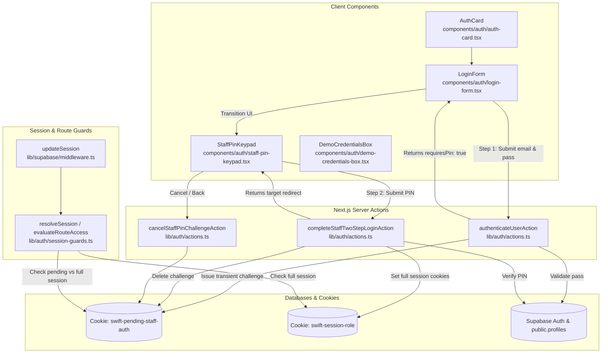

# Technical Implementation Plan: Staff Two-Step Login Sequence (SIAA-106)

**Feature**: Auth: Enforce two-step login sequence (Password then PIN) for all staff roles  
**Ticket**: [SIAA-106](https://the-three-devsketeers.atlassian.net/browse/SIAA-106)  
**Date**: 2026-10-26  

---

## 1. System Architecture & Component Mapping

---

## 2. File Modification & Creation Inventory

| File Path | Action | Description |
| :--- | :--- | :--- |
| `specs/106-two-step-login-staff-roles/*` | Create | 8 canonical SpecKit artifacts. |
| `specs/106-two-step-login-staff-roles/contracts/two-step-auth.contract.ts` | Create | Contract schemas for two-step authentication inputs and results. |
| `lib/auth/types.ts` | Modify | Add `PendingStaffAuthChallenge`, `PendingStaffSummary`, `TwoStepAuthResult`. |
| `lib/auth/actions.ts` | Modify | Update `authenticateUserAction` to intercept staff logins with `swift-pending-staff-auth`; add `completeStaffTwoStepLoginAction` and `cancelStaffPinChallengeAction`. |
| `lib/auth/session-guards.ts` | Modify | Detect `swift-pending-staff-auth` cookie; block unverified access to `/staff/*` with redirect to `/login?notice=pin_required`. |
| `components/auth/staff-pin-keypad.tsx` | Create | Dedicated numeric keypad with 0-9 touch buttons, dot indicators, clear, backspace, and "Back to Login" action. |
| `components/auth/login-form.tsx` | Modify | Implement state machine (`step: 'CREDENTIALS' \| 'PIN'`); render `StaffPinKeypad` during Step 2. |
| `components/auth/auth-card.tsx` | Modify | Support resuming pending PIN challenges when initial load contains pending cookie. |
| `lib/auth/__tests__/two-step-login.test.ts` | Create | Automated unit & integration tests covering Step 1, Step 2 valid/invalid PIN, direct URL bypass interception, and cookie transitions. |

---

## 3. Test Strategy & Acceptance Matrix

1. **Step 1 Completion**:
   - Submitting valid staff credentials sets `swift-pending-staff-auth` cookie, does NOT set `swift-session-role`, returns `requiresPin: true`.
2. **Step 2 Valid PIN**:
   - Submitting correct PIN deletes `swift-pending-staff-auth`, sets `swift-session-role = 'staff'`, redirects to staff portal.
3. **Step 2 Incorrect PIN**:
   - Submitting wrong PIN returns `"Invalid PIN. Please try again."`, no session cookies granted.
4. **Direct Route Bypass Prevention**:
   - Calling `evaluateRouteAccess('/staff/pos', { isAuthenticated: false, hasPendingPinChallenge: true })` returns `{ action: 'REDIRECT', destination: '/login?notice=pin_required' }`.
5. **Admin Single-Step Preserved**:
   - Admin login directly authenticates and routes to `/admin`.
