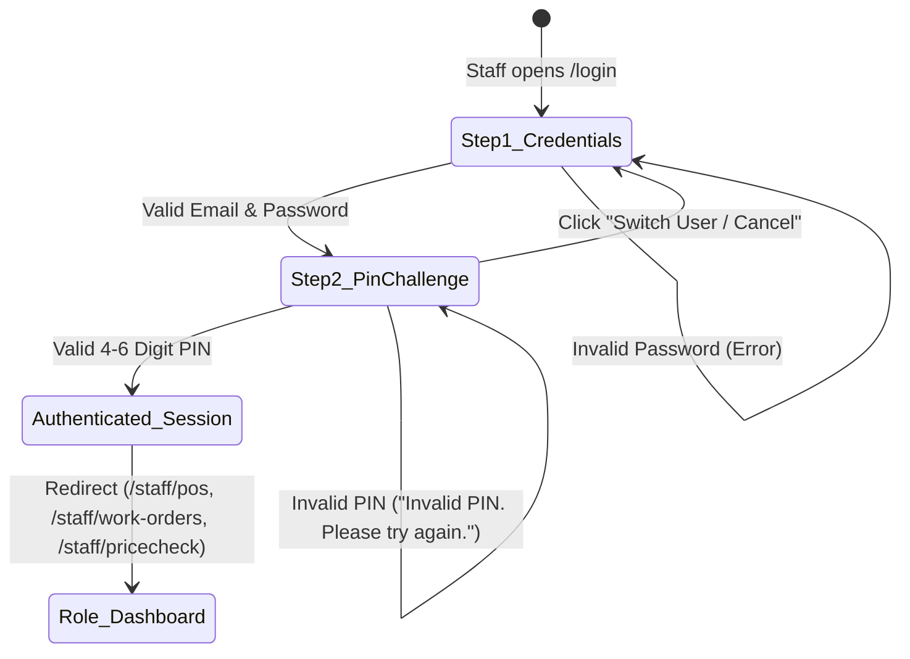

# Technical Research & Architecture Decisions: Staff Two-Step Login Sequence (SIAA-106)

**Feature**: Auth: Enforce two-step login sequence (Password then PIN) for all staff roles  
**Ticket**: [SIAA-106](https://the-three-devsketeers.atlassian.net/browse/SIAA-106)  
**Date**: 2026-10-26  

---

## 1. Problem Context & Existing Architecture

### Current Authentication Flow
- Currently, `authenticateUserAction` in `lib/auth/actions.ts` validates credentials and directly issues full session cookies:
  - `swift-session-role` (`admin` or `staff`)
  - `swift-user-name`
  - `swift-session-user-id`
- Once these cookies are set, the browser is immediately redirected to `/admin` or `/staff/pos`.
- Staff members are never prompted for their numeric PIN during standard `/login` authentication, creating a major security deficiency on shared shop terminals where frontline workers (Cashiers, Mechanics, Inventory Clerks) operate.

### Existing PIN Capabilities in Codebase
- Migration `20261021000000_staff_kiosk_auth_rpcs.sql` introduced `pin_code VARCHAR(10)` to `public.profiles`.
- SIAA-104 ratified `StaffPinSchema` (`/^\d{4,6}$/`) with the invariant error message: *"PIN must consist of 4 to 6 numeric digits."*
- `DEMO_STAFF_ACCOUNTS` in `lib/auth/constants.ts` already features pre-configured PINs for all staff accounts:
  - Cashier (`cashier@swift.local`): PIN `1234`
  - Mechanic (`mechanic1@swift.local`): PIN `2222`
  - Inventory Clerk (`warehouse@swift.local`): PIN `3333`
- `components/staff/clock/staff-pin-modal.tsx` contains an existing tactile touch keypad and dot-masking pattern that can be unified for the staff login card.

---

## 2. Architecture Decisions & Technical Approaches

### Decision 1: Two-Stage State Machine for Staff Authentication



1. **Step 1 Action (`authenticateUserAction` or `initiateStaffLoginAction`)**:
   - Accepts `{ email, password, selectedRole, rememberTerminal }`.
   - Validates email and password against Supabase Auth (or authorized demo accounts).
   - Verifies the account is active (`status !== 'Inactive' && status !== 'Suspended'`).
   - If `selectedRole === 'admin'`: Completes login directly, sets admin cookies, and redirects to `/admin`.
   - If `selectedRole === 'staff'` (or user is a staff role):
     - Does **NOT** set `swift-session-role`.
     - Sets an intermediate, HTTP-only signed challenge cookie `swift-pending-staff-auth` containing:
       ```json
       {
         "userId": "00000000-0000-0000-0000-000000000002",
         "email": "cashier@swift.local",
         "name": "Mike Morales",
         "role": "cashier",
         "portalRole": "staff",
         "targetUrl": "/staff/pos",
         "rememberTerminal": true,
         "challengeIssuedAt": 1729910000
       }
       ```
     - Returns `{ success: true, requiresPin: true, step: 'ENTER_PIN', staffSummary: { name, email, role, targetUrl } }`.

2. **Step 2 Action (`completeStaffTwoStepLoginAction`)**:
   - Accepts `{ pin, rememberTerminal }`.
   - Reads `swift-pending-staff-auth` from cookie store.
   - If no challenge cookie is present, rejects with `"Session challenge expired. Please enter your password again."`
   - Validates `pin` via `StaffPinSchema` (`/^\d{4,6}$/`).
   - Verifies PIN against `public.profiles.pin_code` (or demo profile / memory store).
   - If incorrect: Returns `{ success: false, error: "Invalid PIN. Please try again.", code: "INVALID_PIN" }`.
   - If valid:
     - Deletes `swift-pending-staff-auth`.
     - Sets authoritative cookies: `swift-session-role`, `swift-user-name`, `swift-session-user-id`.
     - Logs security audit event: `"Staff two-step authentication completed for: <email>"`.
     - Returns `{ success: true, redirectTo: staffSummary.targetUrl || "/staff/pos" }`.

3. **Cancel Challenge Action (`cancelStaffPinChallengeAction`)**:
   - Deletes `swift-pending-staff-auth` cookie.
   - Allows user to return cleanly to Step 1.

---

### Decision 2: Direct URL Route Guard Enforcement (`evaluateRouteAccess`)

In `lib/auth/session-guards.ts`:
- If `swift-pending-staff-auth` cookie is present but `swift-session-role` is absent:
  - Route classification for `/staff/*` evaluates to `REDIRECT` with destination `/login?notice=pin_required`.
  - The request cannot reach `/staff/pos`, `/staff/work-orders`, or `/staff/pricecheck`.
- When `/login` or `/` loads:
  - `getServerSession` detects the pending challenge cookie.
  - Page can hydrate with `hasPendingPinChallenge: true` and prefill the staff member's name and email in the Step 2 view, preventing operator disorientation.

---

### Decision 3: Touch Keypad & Visual Presentation

- Implemented in `components/auth/staff-pin-keypad.tsx` or integrated inside `LoginForm`.
- Keypad layout:
  - 3x4 grid: digits 1 to 9, Clear (`RotateCcw`), digit 0, Backspace (`Delete`).
  - Tactile states: `hover:bg-bg-hover active:bg-primary-light active:scale-95`.
  - Visual dot indicators: 4 to 6 dot slots that fill dynamically as digits are entered.
  - Auto-submit or explicit "Authorize Terminal" action button.
  - Full keyboard accessibility: handles physical NumPad / number keys `0-9`, `Backspace`, `Enter`, and `Escape`.
- Zero hardcoded colors: uses semantic variables (`var(--primary)`, `var(--bg-card)`, `var(--border)`).
