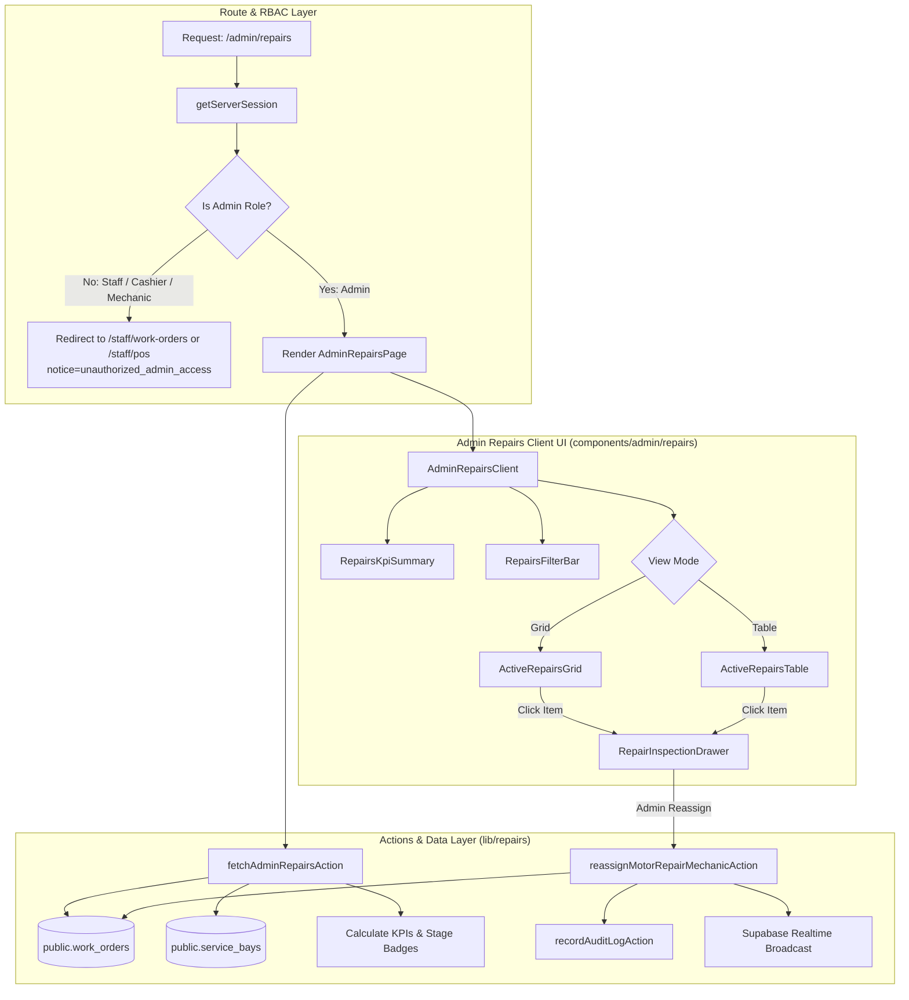

# Implementation Plan: Admin Motor Repair Tracking & Workshop Service Bay Monitoring Dashboard

**Feature**: `specs/107-admin-motor-repair-tracking/spec.md`  
**Date**: 2026-10-26  
**Jira Ticket**: [SIAA-107](https://the-three-devsketeers.atlassian.net/browse/SIAA-107)  

---

## 1. Architecture Overview & Component Boundaries

---

## 2. File Modification & Creation Roadmap

### 2.1 Contracts & Types
- Create `lib/repairs/repairs-contracts.ts`:
  - `AdminMotorRepairItem`, `RepairsDashboardKpiSummary`, `RepairsFilterState`, `AdminReassignMechanicSchema`, `RepairStageBadge`.

### 2.2 Server Actions & Data Layer
- Create `lib/repairs/repairs-actions.ts`:
  - `fetchAdminRepairsAction()`: Retrieves work orders, transforms records into `AdminMotorRepairItem[]`, extracts vehicle make/model/chassis, calculates elapsed/remaining times, computes KPI metrics.
  - `reassignMotorRepairMechanicAction(payload)`: Reassigns work order mechanic, writes audit log, broadcasts realtime event, safely revalidates `/admin/repairs`.
  - Resilience fallback: Integrates with `lib/workshop/workshop-mock-data.ts` and `lib/workshop/workshop-actions.ts` when offline.

### 2.3 Navigation Update
- Update `lib/admin/navigation.ts`:
  - Add `{ id: "repairs", label: "Workshop Repairs", href: "/admin/repairs", category: "Store Intelligence", icon: Wrench }` to `ADMIN_NAV_ITEMS`.

### 2.4 UI Components
- Create `components/admin/repairs/repairs-kpi-summary.tsx`:
  - 4 KPI metric cards (Active Motors, In Repair, Waiting for Parts, Bay Utilization) styled with SWIFT semantic design tokens and micro-animations.
- Create `components/admin/repairs/repairs-filter-bar.tsx`:
  - Instant search input (by plate, vehicle, customer), stage badge pills, mechanic dropdown, bay filter, and Grid/Table view switch.
- Create `components/admin/repairs/repair-motor-card.tsx`:
  - Rich motorcycle card displaying make/model, plate number, chassis token, customer name, contact phone, assigned mechanic, bay, complaint, stage badge, and elapsed time progress.
- Create `components/admin/repairs/repairs-table.tsx`:
  - Responsive desktop table for high-density workshop monitoring.
- Create `components/admin/repairs/repair-inspection-drawer.tsx`:
  - Slide-over drawer with backdrop displaying vehicle banner, mechanic punch-in duration, task checklist with status indicators, installed parts list with shelf locations, floor notes, and on-shift mechanic reassignment select.
- Create `components/admin/repairs/admin-repairs-client.tsx`:
  - Root client controller coordinating state, real-time polling/broadcast, filter query evaluation, and drawer actions.

### 2.5 Route Views
- Create `app/admin/repairs/page.tsx`:
  - Server Component enforcing RBAC via `getServerSession()` and mounting `AdminRepairsClient`.

### 2.6 Tests
- Create `lib/repairs/__tests__/repairs-actions.test.ts`:
  - Verifies data fetching, KPI calculations, filtering logic, mechanic reassignment, and RBAC guard decisions.
