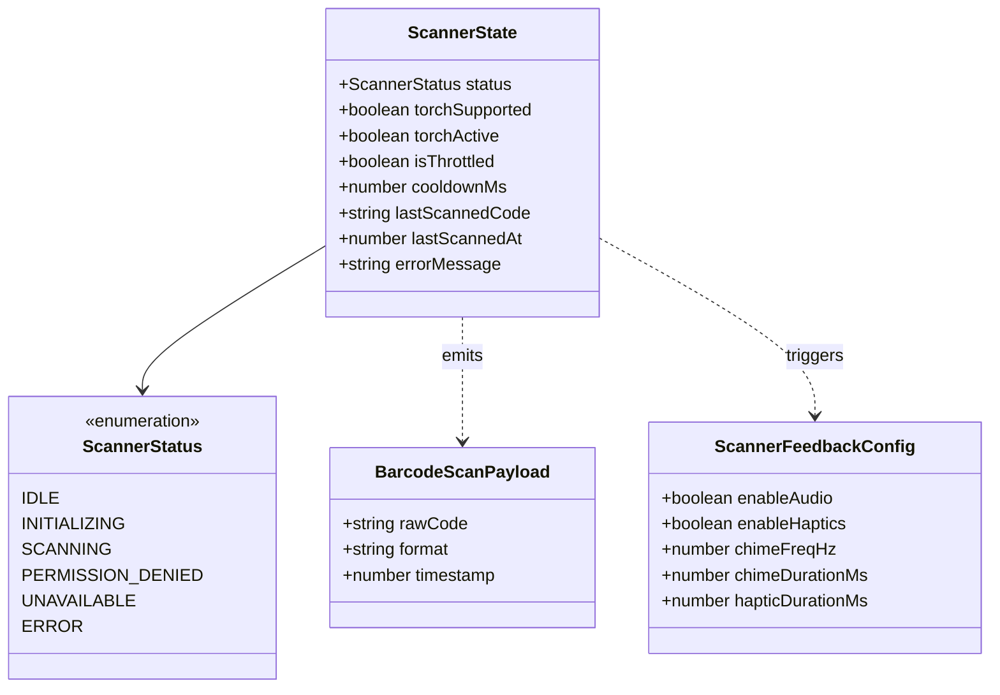

# Data Model & Domain Architecture: POS Mobile Companion Scanner (SIAA-110)

## 1. Domain Entities & Value Objects



---

## 2. Type Definitions & Zod Schemas

### `BarcodeScanPayload`
Represents an individual barcode or SKU scan capture.
```typescript
export interface BarcodeScanPayload {
  rawCode: string;
  format: string; // e.g., 'EAN_13', 'CODE_128', 'QR_CODE', 'MANUAL'
  timestamp: number;
}
```

### `ScannerStatus`
Current operational lifecycle of the mobile camera engine.
- `IDLE`: Not started.
- `INITIALIZING`: Requesting `getUserMedia` and setting up viewfinder.
- `SCANNING`: Actively capturing and analyzing video frames at 30+ fps.
- `PERMISSION_DENIED`: User or browser denied camera access.
- `UNAVAILABLE`: Device has no rear camera or MediaDevices API is unsupported.
- `ERROR`: Unexpected stream or decoding failure.

### `ScannerFeedbackConfig`
Parameters governing synthetic audio generation and haptic vibration:
```typescript
export interface ScannerFeedbackConfig {
  enableAudio: boolean;       // Default: true
  enableHaptics: boolean;     // Default: true
  beepFreqHz: number;         // Default: 1000 (Hz)
  beepDurationMs: number;     // Default: 80 (ms)
  hapticDurationMs: number;   // Default: 80 (ms)
  cooldownMs: number;         // Default: 1500 (ms)
}
```

---

## 3. Storage & State Management Invariants

1. **Client Ephemeral State**:
   - `isThrottled`: Tracked in `useRef` to prevent re-render thrashing during continuous video stream decoding.
   - `lastScannedCode`: Stored for 1500ms to de-duplicate successive frames of the same physical label.
2. **Realtime Broadcast Integration**:
   - When URL query parameter `?session={sessionKey}` is present, scans automatically stream to Supabase Realtime channel `pos-channel:{sessionKey}` under event `BARCODE_SCANNED`.
   - When no session key is passed, the scanner functions in local verification mode with toast feedback.
