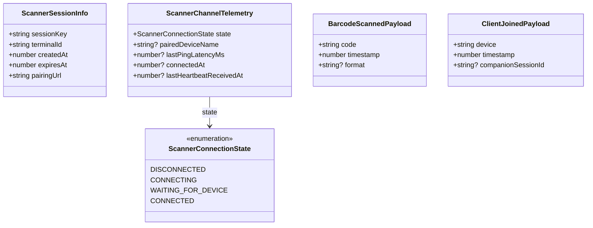
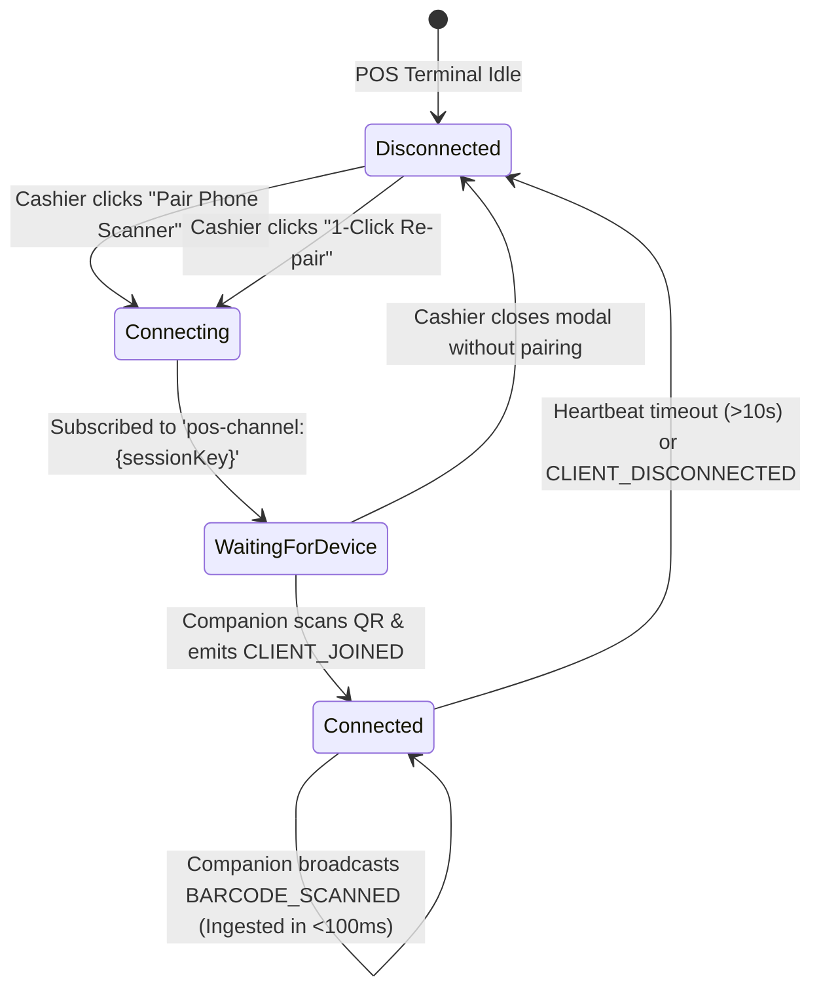

# Domain Data Models: POS Terminal QR Code Session Pairing & Realtime Broadcast

**Feature**: `111-pos-terminal-qr-session-pairing`  
**Jira Ticket**: [SIAA-111](https://the-three-devsketeers.atlassian.net/browse/SIAA-111)  
**Parent Epic**: [SIAA-109](https://the-three-devsketeers.atlassian.net/browse/SIAA-109)  

---

## 1. Domain Entities & State Machine



---

## 2. Pairing & Broadcast Lifecycle State Flow



---

## 3. Realtime Broadcast Event Specifications

1. **`CLIENT_JOINED`**: Emitted by companion mobile web browser upon page mount.
   ```json
   {
     "device": "Mobile Safari / iPhone 15",
     "timestamp": 1732628400120,
     "companionSessionId": "cmp-8a21f"
   }
   ```

2. **`TERMINAL_ACK`**: Emitted by desktop POS terminal in response to `CLIENT_JOINED`.
   ```json
   {
     "terminalId": "T1",
     "timestamp": 1732628400140
   }
   ```

3. **`HEARTBEAT`**: Companion periodic keep-alive ping emitted every 3 seconds.
   ```json
   {
     "sender": "companion",
     "timestamp": 1732628403000
   }
   ```

4. **`HEARTBEAT_ACK`**: Terminal response measuring round-trip latency.
   ```json
   {
     "sender": "terminal",
     "pingTimestamp": 1732628403000,
     "ackTimestamp": 1732628403025,
     "latencyMs": 25
   }
   ```

5. **`BARCODE_SCANNED`**: Dispatched when camera or hardware reads a barcode.
   ```json
   {
     "code": "HON-BRK-01",
     "timestamp": 1732628405000,
     "format": "CODE_128"
   }
   ```

6. **`CLIENT_DISCONNECTED`**: Dispatched during graceful unmount.
   ```json
   {
     "reason": "user_exit",
     "timestamp": 1732628450000
   }
   ```
