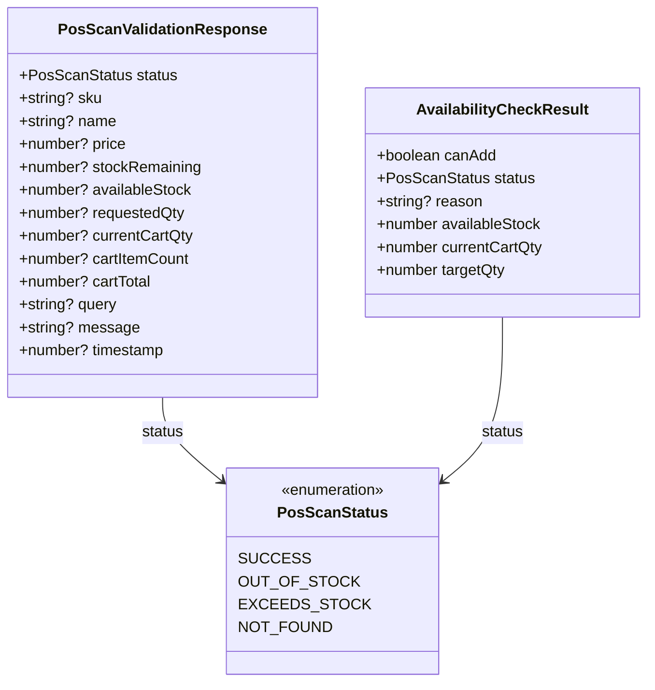
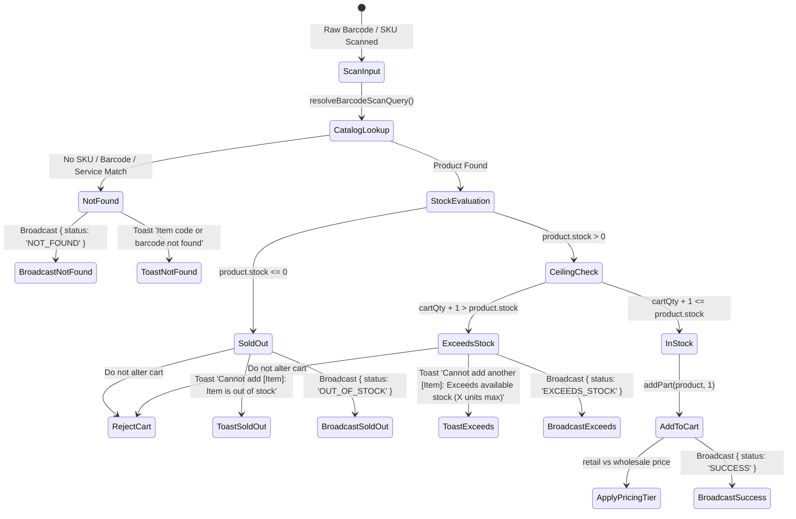

# Domain Data Models: POS Real-Time Availability Validation & Sold-Out Rejection

**Feature**: `112-pos-realtime-availability-validation`  
**Jira Ticket**: [SIAA-112](https://the-three-devsketeers.atlassian.net/browse/SIAA-112)  
**Parent Epic**: [SIAA-109](https://the-three-devsketeers.atlassian.net/browse/SIAA-109)  

---

## 1. Domain Entities & Validation Enums



---

## 2. State Transition Flow



---

## 3. Realtime Broadcast Payload Specifications

### Success Payload:
```json
{
  "status": "SUCCESS",
  "sku": "YAM-NMAX-BL01",
  "name": "Yamaha NMAX Brake Pad Set",
  "price": 480.00,
  "stockRemaining": 11,
  "cartItemCount": 1,
  "cartTotal": 480.00,
  "timestamp": 1732628400000
}
```

### Out-of-Stock Payload:
```json
{
  "status": "OUT_OF_STOCK",
  "sku": "HON-CLK-DRV01",
  "name": "Honda Click Drive Belt 125i",
  "requestedQty": 1,
  "availableStock": 0,
  "message": "Item is sold out",
  "timestamp": 1732628400000
}
```

### Exceeds Stock Payload:
```json
{
  "status": "EXCEEDS_STOCK",
  "sku": "MOT-3100-10W40",
  "name": "Motul 3100 Silver 10W40 1L",
  "currentCartQty": 2,
  "availableStock": 2,
  "message": "Cannot add another Motul 3100 Silver 10W40 1L: Exceeds available stock (2 units max)",
  "timestamp": 1732628400000
}
```

### Not Found Payload:
```json
{
  "status": "NOT_FOUND",
  "query": "INVALID-SKU-99",
  "message": "Barcode not found in catalog",
  "timestamp": 1732628400000
}
```
