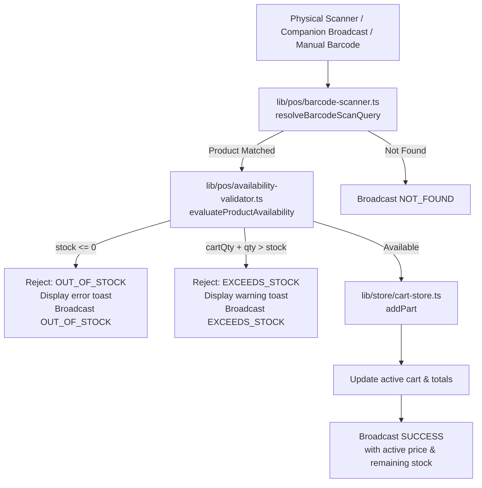

# Technical Implementation Plan: POS Real-Time Availability Validation & Sold-Out Rejection

**Feature**: `112-pos-realtime-availability-validation`  
**Jira Issue**: [SIAA-112](https://the-three-devsketeers.atlassian.net/browse/SIAA-112)  
**Parent Epic**: [SIAA-109](https://the-three-devsketeers.atlassian.net/browse/SIAA-109)  

---

## 1. System Architecture & Component Mapping

---

## 2. File Modification Boundaries

1. **Contracts & Validation Definitions**:
   - `specs/112-pos-realtime-availability-validation/contracts/pos-scan-validation.contract.ts`
   - Re-exported or imported into `lib/contracts/pos-scan-validation.ts` or `lib/pos/barcode-scanner.ts`.

2. **Availability Validation Engine**:
   - `lib/pos/barcode-scanner.ts`:
     - Implement `evaluateProductAvailability(product: Product, currentCartQty: number, requestedQty?: number): AvailabilityCheckResult`
     - Integrate with `resolveBarcodeScanQuery`.

3. **Cart Store Stock Enforcement**:
   - `lib/store/cart-store.ts`:
     - Ensure `addPart` cleanly verifies stock, returning `{ success: false, reason: 'out_of_stock' }` or `{ success: false, reason: 'exceeds_stock' }`.
     - Support query methods to check current quantity of an item in the cart.

4. **Desktop POS Terminal Integration**:
   - `app/staff/pos/page.tsx`:
     - Update `handleSelectProduct` to:
       - Validate availability against current cart quantity.
       - Display exact toasts:
         - Sold out: `Cannot add ${product.name}: Item is out of stock.`
         - Exceeds ceiling: `Cannot add another ${product.name}: Exceeds available stock (${product.stock} units max)`
       - Broadcast `PosScanValidationResponse` to companion phone channel.
     - Update `handleScanNotFound` to:
       - Broadcast `{ status: 'NOT_FOUND', query, message: 'Barcode not found in catalog' }`.

5. **Broadcast Channel Utility**:
   - `lib/pos/companion-broadcast.ts`:
     - Safe non-blocking broadcast helper `broadcastScanValidationResult(payload: PosScanValidationResponse, pairingCode?: string)`.

6. **Unit Tests (TDD)**:
   - `lib/pos/__tests__/barcode-scanner.test.ts` (extend with SIAA-112 test scenarios).
   - `lib/pos/__tests__/availability-validator.test.ts` (comprehensive availability & broadcast response testing).
