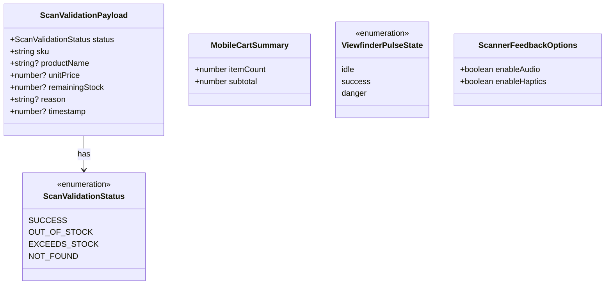
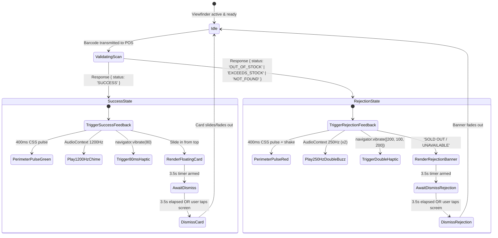

# Domain Data Models: POS Mobile Companion Validation Alerts & Screen Feedback

**Feature**: `113-pos-mobile-companion-validation-alerts`  
**Jira Ticket**: [SIAA-113](https://the-three-devsketeers.atlassian.net/browse/SIAA-113) (STORY-109.4)  
**Parent Epic**: [SIAA-109](https://the-three-devsketeers.atlassian.net/browse/SIAA-109)  

---

## 1. Domain Entities & Type Architecture



---

## 2. State Machine: Validation Card & Screen Alerts



---

## 3. Storage & Realtime Message Structure

When a mobile companion scans an item, the POS terminal verifies availability and broadcasts a payload over the Supabase Realtime channel `pos-session:{pairingCode}`:

```json
{
  "event": "SCAN_VALIDATION_RESULT",
  "payload": {
    "status": "SUCCESS",
    "sku": "YAM-NMAX-BL01",
    "productName": "Yamaha NMAX Brake Pad Set",
    "unitPrice": 480.00,
    "remainingStock": 11,
    "timestamp": 1732628400000
  }
}
```

Or upon rejection:

```json
{
  "event": "SCAN_VALIDATION_RESULT",
  "payload": {
    "status": "OUT_OF_STOCK",
    "sku": "HON-CLK-DRV01",
    "reason": "Requested item has 0 units in stock",
    "remainingStock": 0,
    "timestamp": 1732628400000
  }
}
```

And running cart summary broadcast:

```json
{
  "event": "CART_UPDATED",
  "payload": {
    "itemCount": 4,
    "subtotal": 1420.00
  }
}
```
