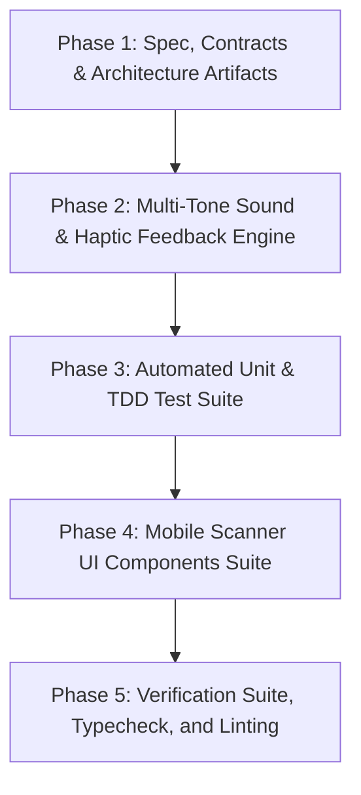

# Implementation Tasks: POS Mobile Companion Validation Alerts & Screen Feedback

**Feature**: `113-pos-mobile-companion-validation-alerts`  
**Jira Issue**: [SIAA-113](https://the-three-devsketeers.atlassian.net/browse/SIAA-113) (STORY-109.4)  
**Parent Epic**: [SIAA-109](https://the-three-devsketeers.atlassian.net/browse/SIAA-109)  
**Spec Reference**: [`specs/113-pos-mobile-companion-validation-alerts/spec.md`](spec.md)  
**Plan Reference**: [`specs/113-pos-mobile-companion-validation-alerts/plan.md`](plan.md)  

---

## Task Matrix & Dependency Graph

---

## Phase 1: Specifications, Contracts & Architecture Artifacts

- [x] **TASK-1.1**: Author specification, research, data model, contracts, checklist, plan, quickstart, and task artifacts for SIAA-113 (`specs/113-pos-mobile-companion-validation-alerts/spec.md`, `research.md`, `data-model.md`, `contracts/validation-card.contract.ts`, `contracts/scanner-feedback.contract.ts`, `checklists/requirements.md`, `plan.md`, `quickstart.md`, `tasks.md`).

---

## Phase 2: Multi-Tone Sound & Haptic Feedback Engine

- [x] **TASK-2.1**: Implement `lib/pos/scanner-feedback.ts`:
  - `playSuccessChime()`: Synthesizes high-pitch 1200Hz sine wave tone via Web Audio API with smooth gain envelope.
  - `playSoldOutBuzzer()`: Synthesizes low-pitch 250Hz tone pulse (double buzz) for out-of-stock / rejected items.
  - `playNotFoundTone()`: Synthesizes 440Hz -> 330Hz sequence for unrecognized items.
  - `triggerSuccessHaptic()`: Triggers crisp 80ms tactile pulse via `navigator.vibrate(80)` with browser feature detection.
  - `triggerRejectionHaptic()`: Triggers double vibration pattern via `navigator.vibrate([200, 100, 200])`.
  - `unlockAudioContext()`: Unlocks / resumes singleton `AudioContext` on user interaction for mobile browser compatibility.
  - Safe browser & SSR checks (`typeof window !== 'undefined'`).

---

## Phase 3: Automated Unit & TDD Test Suite

- [x] **TASK-3.1**: Create `lib/pos/__tests__/scanner-feedback.test.ts`:
  - Test Scenario 1: Verify audio frequencies (1200Hz success, 250Hz buzzer, 440Hz/330Hz not found).
  - Test Scenario 2: Verify haptic vibration parameters (80ms single pulse vs [200, 100, 200] double pulse).
  - Test Scenario 3: Verify graceful no-op behavior in non-browser or non-vibration environments.
  - Test Scenario 4: Verify auto-dismiss duration constants and Zod contract schema validation for payloads.

---

## Phase 4: Mobile Scanner UI Components Suite

- [x] **TASK-4.1**: Create `components/pos/scanner/scan-validation-card.tsx`:
  - Top-anchored floating container with slide-in and fade-out animations.
  - Success state: Product Name, SKU, Unit Price in ₱ (PHP format), and Remaining Stock counter ("X units remaining").
  - Rejection state: High-contrast alert banner ("SOLD OUT / UNAVAILABLE — NOT ADDED TO CART"), exact SKU, and failure reason.
  - Auto-dismiss lifecycle: 3.5s timeout automatically managed via `useEffect` with instant cancel on new scan or tap dismiss.
  - Accessible ARIA live regions (`aria-live="polite"` vs `aria-live="assertive"`).
  - Strictly consumes SWIFT semantic tokens (`var(--success)`, `var(--danger)`, `bg-bg-card`, `border-border`).
- [x] **TASK-4.2**: Create `components/pos/scanner/scanner-viewfinder-overlay.tsx`:
  - Camera reticle frame with corner bracket indicators.
  - Dynamic perimeter border flashing:
    - Emerald green pulse (`#10b981` / `border-success`) for 400ms on success.
    - Crimson red pulse (`#ef4444` / `border-danger`) with alert animation for 400ms on rejection.
    - Resets to neutral idle reticle upon animation end.
- [x] **TASK-4.3**: Create `components/pos/scanner/mobile-cart-summary-dock.tsx`:
  - Compact sticky bottom dock (`fixed bottom-0 inset-x-0 z-30`).
  - Displays live running cart state: `"Cart: X items | Subtotal: ₱Y,YYY.00"`.
  - Consumes SWIFT design tokens (`bg-bg-surface/95 backdrop-blur-md border-border text-text-primary`).

---

## Phase 5: Verification Suite, Typecheck, and Linting

- [x] **TASK-5.1**: Run automated test suite: `node --env-file=.env.local --experimental-strip-types --test lib/pos/__tests__/scanner-feedback.test.ts` and `npm test`.
- [x] **TASK-5.2**: Run TypeScript verification: `npx tsc --noEmit`.
- [x] **TASK-5.3**: Run ESLint validation: `npm run lint`.
- [x] **TASK-5.4**: Run Graphify knowledge graph sync: `graphify . --update`.
